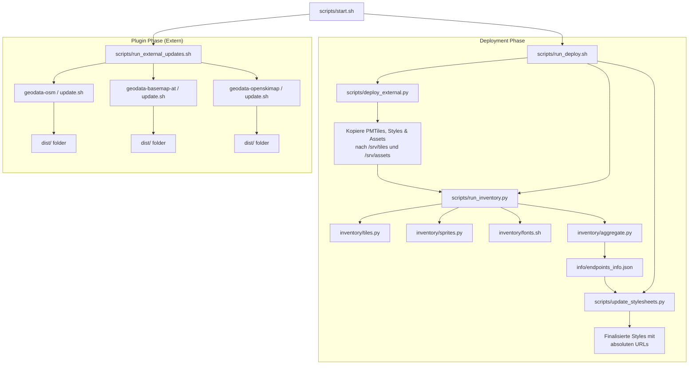

# Geodata Pipeline Ablauf (Mermaid Diagramm)

Die folgende Darstellung zeigt den aktuellen Ablauf der Pipeline basierend auf der Plugin-Architektur.

## Beschreibung des Ablaufs

1. **Orchestrierung:** `start.sh` triggert die Aktualisierung aller in `conf/external_repos.txt` definierten Plugins.
2. **Plugins:** Jedes Plugin baut seine Daten eigenständig und stellt sie im `dist/` Verzeichnis bereit.
3. **Deployment:** `deploy_external.py` sammelt alle Daten basierend auf den `manifest.json` Dateien ein.
4. **Inventarisierung:** Alle verfügbaren Daten auf dem Server werden neu erfasst und in einer zentralen Master-JSON zusammengefasst.
5. **Finalisierung:** Die Stylesheets werden dynamisch an die aktuelle Server-Konfiguration (URLs) angepasst.
